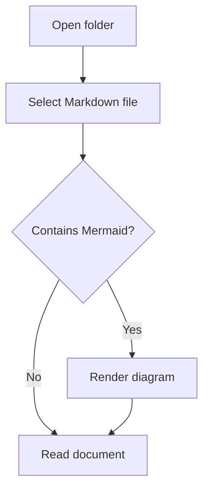

# Markdown Reader

A local, read-only Markdown browser. Point it at a directory to browse Markdown files and subfolders, then click a file to read it as a formatted page in your default browser.

## Requirements

- Node.js 22.12 or newer, with npm.
- A modern browser. The app opens your default browser automatically.

Dependencies need an internet connection to install. Once installed, Markdown and Mermaid rendering run locally without a CDN. Remote images referenced by a document still need access to their source.

## Quick start

Open a terminal in the `md-reader` project directory and run:

```powershell
npm install
npm start -- "C:\path\to\your\notes"
```

The app opens **http://127.0.0.1:3000**. Leave the terminal running while reading; press **Ctrl+C** in the terminal to stop it.

### Windows launcher

Double-click `start-reader.cmd` and enter a directory, or drag a folder onto the launcher. Paste the path without surrounding quotes at the prompt. Press Enter without entering a path to browse the project directory.

The launcher installs dependencies if `node_modules` is missing. After updating the app, run `npm install` again to install any new dependencies.

### Command options

```text
npm start -- [directory] [--port 3000] [--no-open]
```

| Option | Behavior |
| --- | --- |
| `directory` | Root folder to browse. Quote paths containing spaces. Defaults to the project directory when using `npm start`. |
| `--port NUMBER` | Use a different port. The default is `3000`; use `0` to choose a free port automatically. |
| `--no-open` | Start the server without opening a browser. Open the URL printed in the terminal manually. |
| `--help` | Print usage information and exit. |

```powershell
# Choose a different port, or disable automatic browser opening
npm start -- "C:\path\to\notes" --port 3001 --no-open
```

To browse a different root directory, stop the app and start it again with the new path. If you run `node server.js` directly, the default root is your terminal's current directory.

## Reading files

1. Click a subfolder in the sidebar to explore it. Folders appear before files.
2. Click a `.md`, `.markdown`, or `.mdown` file to open its formatted preview.
3. Use **Up** or the breadcrumbs above the document to navigate to a parent folder.

The filter searches names in the current folder; it does not search file contents or nested folders. Click **Refresh** to reload the folder listing and the open document after editing files elsewhere. The reader does not watch for changes automatically.

Browser Back and Forward restore previous locations. You can bookmark a document URL while using the same root directory and port. **Print** opens the browser's print dialog with a document-focused layout.

### Color themes

Choose a theme from the dropdown next to **Print**. Your selection is remembered in the browser. On your first visit, the reader follows your system's light or dark preference.

| Theme | Appearance |
| --- | --- |
| Light | Soft white pages with green accents. |
| Dark | Charcoal green pages with pale green accents. |
| Sepia | Warm cream pages with brown accents. |
| Ocean | Deep blue pages with turquoise accents. |

The theme applies to the sidebar, document, tables, code blocks, and controls. Mermaid diagrams use a matching light or dark appearance.

### Markdown links and images

Headings, tables, fenced code, task lists, quotes, and inline formatting are supported. Relative Markdown links open in the reader, and relative image links display attachments within the selected root:

```markdown
[Related note](./guides/setup.md)
[Section in another note](./guides/setup.md#installation)

```

Local image attachments support PNG, JPEG, GIF, WebP, SVG, and ICO. Other file attachments are not served directly.

## Mermaid diagrams

Use a fenced code block with the language `mermaid` to render a flowchart or another Mermaid diagram:

````markdown

````

Diagrams render as SVG and adapt when you change themes: Light and Sepia use light diagrams; Dark and Ocean use dark diagrams. Expand **Diagram source** beneath a diagram to view its definition. Other fenced code blocks remain ordinary code.

Invalid diagrams show a message and expand their source while the rest of the document stays readable. If Mermaid cannot load, the source remains available. Mermaid uses strict security mode, so diagram click callbacks are disabled.

### Diagram zoom

Use **+** and **−** above each rendered diagram to zoom from 25% to 400% in
25% steps. **Reset** returns that diagram to its initial size (100%), which fits
the available width without enlarging small diagrams. Scroll within an enlarged
diagram to inspect areas outside the viewport.

For keyboard access, focus the diagram and press **+** or **=** to zoom in,
**−** to zoom out, and **0** to reset. Arrow keys scroll the focused diagram.
Each diagram has independent zoom, which is preserved when changing themes.
Opening or refreshing a document resets its zoom. Printing fits diagrams to the
page and hides the zoom controls. Zoom also works with optional Azure icons.

### Optional Azure service icons

Azure icons can be added to flowcharts and architecture diagrams. The reader
does not bundle Microsoft's artwork: install your own pack from the official
download using the [Azure icon installation guide](docs/azure-icons.md).
The importer keeps original artwork, terms, notices, and provenance in ignored
`.local/azure-icons/`. Rendering stays local, with no Azure subscription or paid API.

After reviewing the current Microsoft and archive terms, the import command is:

```powershell
npm run icons:import -- "C:\Downloads\Azure-icons" --archive "C:\Downloads\Azure-icons.zip" --terms "C:\Downloads\Azure-icon-terms.txt" --accept-terms
```

Restart and refresh after installation. Available aliases and examples are in the
guide. Missing packs or aliases show a message and the diagram source.
The importer scans the entire selected folder recursively. Browse
`.local/azure-icons/CATALOG.md` for all installed icon names, source filenames,
and any SVGs skipped during validation. The original seven service aliases are
preserved when available; additional service names are generated automatically.

## Troubleshooting

| Problem | What to do |
| --- | --- |
| `node` or `npm` is not recognized | Install Node.js 22.12 or newer and reopen your terminal. |
| PowerShell blocks `npm.ps1` | Use `npm.cmd` in place of `npm`, or use the Windows launcher. |
| Port 3000 is busy | Restart with `--port 3001` or `--port 0`. |
| The browser does not open | Open the URL printed in the terminal. Check that the server is still running. |
| A Markdown file is missing from the list | Clear the filter, check its extension, and click **Refresh**. Symbolic links are omitted from listings. |
| A file or folder no longer exists | Click **Refresh** or navigate back to its parent folder. |
| A diagram shows an error | Expand **Diagram source** and check the Mermaid syntax. After an app update, run `npm install`, restart the server, and refresh the browser. |
| A relative link or image fails | Check that the target exists within the selected root folder and that its file type is supported. |

## Privacy and limits

- The server listens only on `127.0.0.1`. It is intended for reading on the same computer.
- Files are read only; the app does not edit or upload them.
- Markdown HTML is sanitized before display. Executable Markdown extensions are not processed.
- Paths, including symbolic-link targets, cannot escape the selected root directory.
- Hidden folders are included. There are no configured folder exclusions.
- Documents larger than 10 MB are rejected.
- Your browser may contact external servers to load remote images referenced in a document.

## Verify

Install dependencies first, then run the automated server and Markdown checks:

```powershell
npm test
```

To check actual diagram rendering, run the optional browser smoke test. It launches an installed Chrome or Edge browser in headless mode and checks a valid flowchart, invalid-diagram fallback, ordinary code blocks, and resource loading:

```powershell
npm run test:browser
```

If the test cannot find your browser, set its executable path:

```powershell
$env:BROWSER_PATH = "C:\path\to\chrome.exe"
npm run test:browser
```

The browser test starts its own temporary server and uses temporary Markdown files and a separate browser profile; it does not require the reader to be running.
It tests Azure pack registration with original geometric fixtures, without
downloading or redistributing Microsoft artwork.

## Licensing and releases

Original application code and documentation are available under the [MIT license](LICENSE).
Third-party dependencies and optional Azure artwork retain their own terms; see
[THIRD_PARTY_NOTICES.md](THIRD_PARTY_NOTICES.md). MIT allows commercial reuse;
this project is provided at no charge.

Use `npm ci` for reproducible installations from the committed lockfile. After
updating dependencies, regenerate their notices and check the changes into Git:

```powershell
npm run licenses:generate
npm run licenses:check
```

Include `LICENSE`, `THIRD_PARTY_NOTICES.md`, and the complete `licenses/` directory
in releases, retain dependency notices in any shipped packages, and preserve
license comments in browser bundles. Review generated inventory warnings and
upstream terms before distribution. Do not include `.local/` or Microsoft icon
downloads in MIT-only source releases. The core app works without the optional pack.
