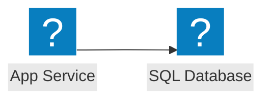

```mermaid
architecture-beta
    service app(azure:app-service)[App Service]
    service db(azure:sql-database)[SQL Database]
    app:R --> L:db
```

# Optional Azure icons

The reader is free to use and its original code is MIT-licensed. Official Azure
artwork has separate Microsoft terms and is not included in Git. No Azure
account, paid service, API key, CDN, or runtime internet connection is needed.

## Install your own pack

1. Open [Microsoft's official Azure icon page](https://learn.microsoft.com/en-us/azure/architecture/icons/).
   Read the current terms and guidelines. Download the SVG ZIP using the official
   download link, and keep that original ZIP for provenance.
2. Extract the ZIP outside this repository. Read any terms and notices inside it.
   Use a supplied terms file for the command below. If the archive has no terms
   file, save the applicable terms from Microsoft's page as a UTF-8 text file.
   Keep a note of when you downloaded it. The importer does not accept terms or
   download Microsoft files on your behalf.
3. In the project directory, run `npm ci`, then:

   ```powershell
   npm run icons:import -- "C:\Downloads\Azure-icons" --archive "C:\Downloads\Azure-icons.zip" --terms "C:\Downloads\Azure-icon-terms.txt" --accept-terms
   ```

   Pass `--accept-terms` only after you have read and accepted the applicable
   Microsoft and archive terms. The importer selects recognized service icons;
   missing services are reported. Ambiguous filenames or unsupported SVG content
   stop the import rather than silently choosing or changing artwork.
4. Restart the reader and refresh your browser. No configuration changes are
   required. The pack is fetched from the local server only when a diagram
   references `azure:`.

## Available aliases

The actual installed aliases are listed in `.local/azure-icons/SOURCE.json`.
Availability depends on which files are in the downloaded archive.

| Alias | Recognized official filename suffix (without `.svg`) |
| --- | --- |
| `azure:app-service` | `App-Services` or `App-Service` |
| `azure:functions` | `Function-Apps` or `Functions` |
| `azure:aks` | `Kubernetes-Services` or `Azure-Kubernetes-Service` |
| `azure:storage` | `Storage-Accounts` |
| `azure:sql-database` | `SQL-Database` or `SQL-Databases` |
| `azure:key-vault` | `Key-Vaults` or `Key-Vault` |
| `azure:azure-openai` | `Azure-OpenAI` or `Azure-OpenAI-Service` |

Numeric prefixes such as `10035-` are ignored when matching filenames. Other
services can be added explicitly to `selections` in `scripts/import-azure-icons.mjs`.

## Example flowchart

````markdown

````

## Example architecture diagram

````markdown

````

These examples require the corresponding icons to have been installed. Missing
packs and aliases display a message and the diagram source. Ordinary Mermaid
diagrams continue to work without Azure artwork.

## Artwork and provenance

`.local/azure-icons/` is ignored by Git and contains:

- `azure-icons.json`: the generated Mermaid icon pack.
- `originals/`: byte-for-byte copies of the selected SVGs.
- `TERMS.txt`: an unchanged copy of the terms you supplied.
- `notices/`: license, terms, copyright, copying, and notice files found in the extracted archive.
- `SOURCE.json`: the official source URL, import timestamp, archive name and
  SHA-256, supplied terms filename and SHA-256, original paths and SVG SHA-256s,
  copied notice paths, and unavailable aliases.

Checksums record the files you supplied; they do not authenticate the download
or verify that the extracted folder matches the ZIP. Obtain both from Microsoft.
Retain the original download and any additional archive documentation yourself.

The converter retains original SVG colors, coordinates, and proportions. It
rejects scripts, external references, and unsupported elements. It does not
recolor the artwork when switching themes. Use icons to identify the actual
Azure services in architecture diagrams, training, or documentation, with nearby
service names. Do not crop, flip, rotate, distort, or use them as your own branding.
The linked Microsoft terms govern the artwork; the project MIT license does not.

To replace a pack, stop the server, move `.local/azure-icons` to a backup location,
then import a fresh pack. The importer refuses to overwrite an existing directory
so that notices from different releases are not mixed. Remove or move that local
directory to uninstall, then restart and refresh.

## Repository and release policy

Commit importer code, examples, project licensing, and dependency notices.
Keep `.local/`, downloaded ZIPs, and extracted Microsoft artwork outside source
commits and MIT-only releases. Users install their own icon pack. Before a
separate redistribution of artwork for a permitted use, review Microsoft's
current and archive terms and include the applicable notices and provenance.

See [THIRD_PARTY_NOTICES.md](../THIRD_PARTY_NOTICES.md) for software notices and
the release process. Do not remove license comments from Mermaid's bundles.
