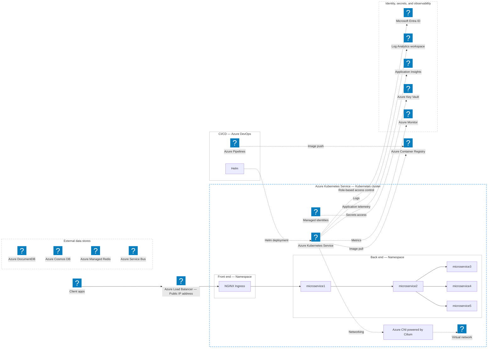

# AKS microservices with CI/CD and external data stores

Public Mermaid recreation of the supplied Azure Kubernetes Service reference
image. It shows the ingress request path, front-end and back-end namespaces,
container delivery, and supporting platform services.

Install the [optional Azure and supplemental Entra icon packs](../azure-icons.md) before opening this
example in the reader. Use the diagram's zoom controls to inspect the details.

## Reading the diagram

- **Solid arrows** reproduce the request path: client apps → public load
  balancer → ingress → microservice1 → microservice2 → microservices 3, 4, and 5.
- **Dashed arrows** distinguish delivery and platform relationships from request
  traffic: image push/pull, Helm deployment, role-based access control, networking,
  telemetry, and managed-identity access to Key Vault.
- **External data stores** reproduce the reference's list. Connections from
  individual microservices are deliberately unspecified, as in the image.
- The front-end and back-end boxes represent Kubernetes namespaces inside one
  cluster; the drawing is conceptual, not a deployment manifest.

The NGINX, Helm, and Cilium labels use text rather than bundling additional logo
packs. Microservices use generic nodes so Azure Container Instances artwork is
not mistaken for an AKS workload. The standalone Microsoft Entra ID logo is
loaded from the separately installed official Entra icon pack as `azure:entra-id`.

Only Markdown and Mermaid source are included in this repository. The original
image, Microsoft branding, and Azure SVG artwork are not bundled with the sample.
Icons are loaded from each user's separately installed local pack under the
applicable Microsoft terms; see [third-party notices](../../THIRD_PARTY_NOTICES.md).
