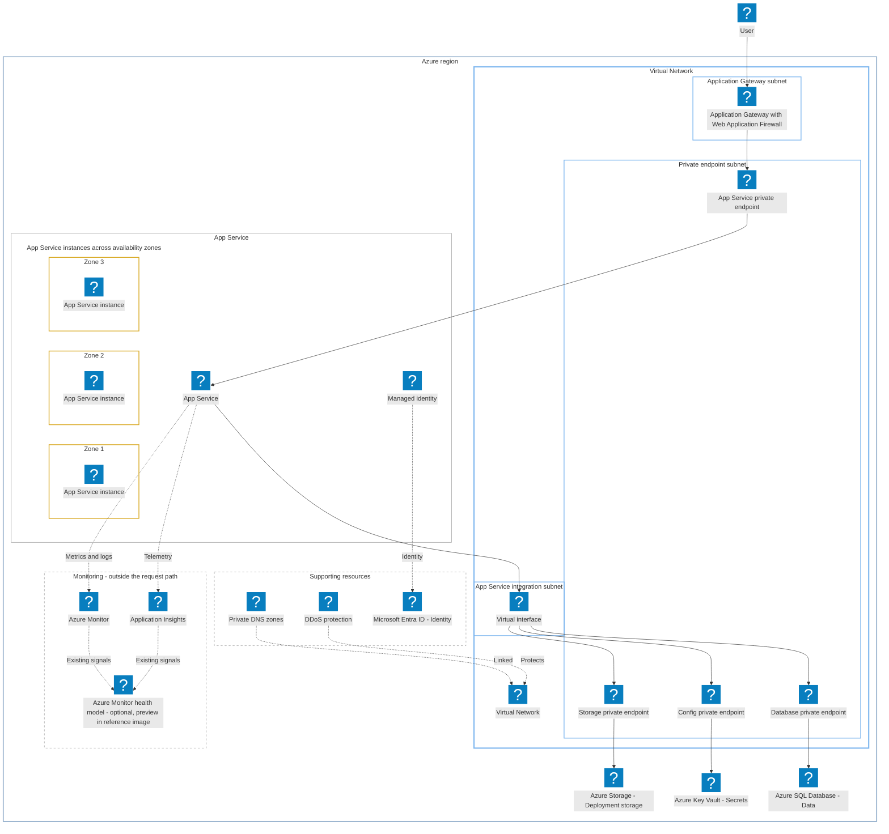

# Private Azure web application

Mermaid recreation of the supplied Azure architecture image. Layout is adapted
for the reader; the subnets, private endpoints, service instances, and supporting
resources follow the reference. Solid arrows show application connectivity;
dotted lines show DNS, protection, identity, and monitoring relationships.

This example requires the [optional Azure and supplemental Entra icon packs](../azure-icons.md).
Use the diagram's **+**, **−**, and **Reset** controls to inspect the details.

The health-model preview label reproduces the supplied reference image rather
than asserting current Azure availability. The source image's Microsoft branding
and artwork are not bundled here; the service icons come from your local pack.
The standalone Entra ID logo comes from the supplemental official Entra pack
rather than substituting another service's icon.
